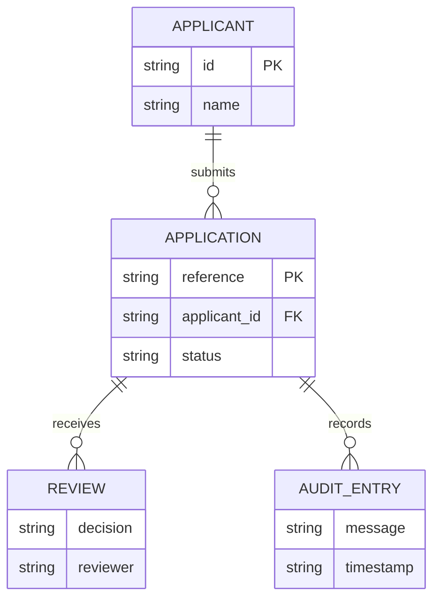
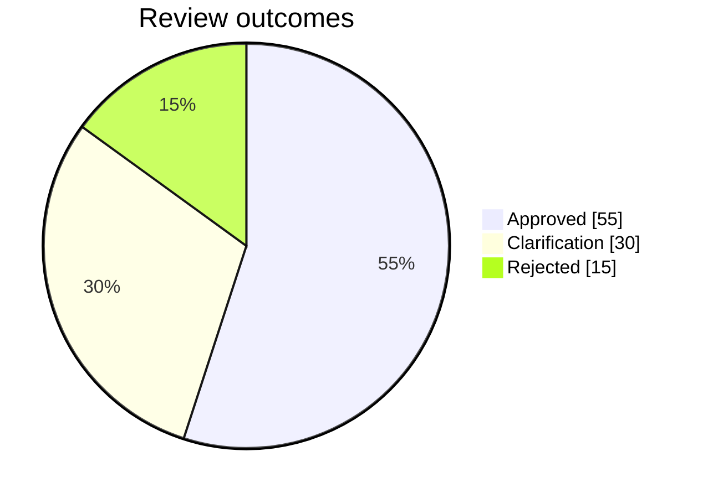

# Demo

Mermaid source and SVG output from mer-md. The SVGs follow your browser's light or dark preference.

## Flowchart

```text
flowchart TD
    request[Receive request] --> validate{Complete details?}
    validate -->|Yes, continue processing| approve[Approve request]
    validate -->|No, request clarification| clarify[Ask for details]
    clarify -->|Updated request| request
    approve --> record[Record decision]
    record --> notify[Notify applicant]
    approve -.->|Audit copy| audit[(Audit log)]
    notify --> done([Complete])
```

<!-- portable-mermaid:begin id=demo-flowchart -->

<p align="center">
  
</p>

<!-- portable-mermaid:source
```mermaid
flowchart TD
    request[Receive request] --&gt; validate{Complete details?}
    validate --&gt;|Yes, continue processing| approve[Approve request]
    validate --&gt;|No, request clarification| clarify[Ask for details]
    clarify --&gt;|Updated request| request
    approve --&gt; record[Record decision]
    record --&gt; notify[Notify applicant]
    approve -.->|Audit copy| audit[(Audit log)]
    notify --&gt; done([Complete])
```
-->
<!-- portable-mermaid:end -->

## Sequence

```text
sequenceDiagram
    actor Applicant
    participant Portal
    participant Records
    Applicant->>Portal: Submit application
    Portal->>Records: Validate details
    alt Complete application
        Records-->>Portal: Validation passed
        Portal-->>Applicant: Confirmation number
    else Missing details
        Records-->>Portal: Required fields
        Portal-->>Applicant: Request clarification
    end
    Note over Portal,Records: Retain an audit trail
```

<!-- portable-mermaid:begin id=demo-sequence -->

<p align="center">
  
</p>

<!-- portable-mermaid:source
```mermaid
sequenceDiagram
    actor Applicant
    participant Portal
    participant Records
    Applicant->>Portal: Submit application
    Portal->>Records: Validate details
    alt Complete application
        Records--&gt;>Portal: Validation passed
        Portal--&gt;>Applicant: Confirmation number
    else Missing details
        Records--&gt;>Portal: Required fields
        Portal--&gt;>Applicant: Request clarification
    end
    Note over Portal,Records: Retain an audit trail
```
-->
<!-- portable-mermaid:end -->

## State

```text
stateDiagram-v2
    [*] --> Draft
    Draft --> Review: Submit for approval
    Review --> Draft: Request more details
    Review --> Approved: All checks passed
    Review --> Rejected: Checks failed
    Approved --> Approved: Record audit note
    Approved --> [*]: Deliver service
    Rejected --> [*]: Notify applicant
```

<!-- portable-mermaid:begin id=demo-state -->

<p align="center">
  
</p>

<!-- portable-mermaid:source
```mermaid
stateDiagram-v2
    [*] --&gt; Draft
    Draft --&gt; Review: Submit for approval
    Review --&gt; Draft: Request more details
    Review --&gt; Approved: All checks passed
    Review --&gt; Rejected: Checks failed
    Approved --&gt; Approved: Record audit note
    Approved --&gt; [*]: Deliver service
    Rejected --&gt; [*]: Notify applicant
```
-->
<!-- portable-mermaid:end -->

## Classes

```text
classDiagram
    class Application {
        +String reference
        +submit()
    }
    class Review {
        +String decision
        +approve()
    }
    class Applicant {
        +String name
    }
    class AuditEntry {
        +String message
    }
    Applicant "1" --> "many" Application : submits
    Application "1" *-- "many" Review : records
    Review --> AuditEntry : creates audit entry
    Application --> AuditEntry : preserves history
```

<!-- portable-mermaid:begin id=demo-class -->

<p align="center">
  
</p>

<!-- portable-mermaid:source
```mermaid
classDiagram
    class Application {
        +String reference
        +submit()
    }
    class Review {
        +String decision
        +approve()
    }
    class Applicant {
        +String name
    }
    class AuditEntry {
        +String message
    }
    Applicant "1" --&gt; "many" Application : submits
    Application "1" *-- "many" Review : records
    Review --&gt; AuditEntry : creates audit entry
    Application --&gt; AuditEntry : preserves history
```
-->
<!-- portable-mermaid:end -->

## Entity relationships

```text
erDiagram
    APPLICANT ||--o{ APPLICATION : submits
    APPLICATION ||--o{ REVIEW : receives
    APPLICATION ||--o{ AUDIT_ENTRY : records
    APPLICANT {
        string id PK
        string name
    }
    APPLICATION {
        string reference PK
        string applicant_id FK
        string status
    }
    REVIEW {
        string decision
        string reviewer
    }
    AUDIT_ENTRY {
        string message
        string timestamp
    }
```

<!-- portable-mermaid:begin id=demo-er -->

<p align="center">
  
</p>

<!-- portable-mermaid:source

-->
<!-- portable-mermaid:end -->

## Pie chart

```text
pie showData
    title Review outcomes
    "Approved" : 55
    "Clarification" : 30
    "Rejected" : 15
```

<!-- portable-mermaid:begin id=demo-pie -->

<p align="center">
  
</p>

<!-- portable-mermaid:source

-->
<!-- portable-mermaid:end -->
