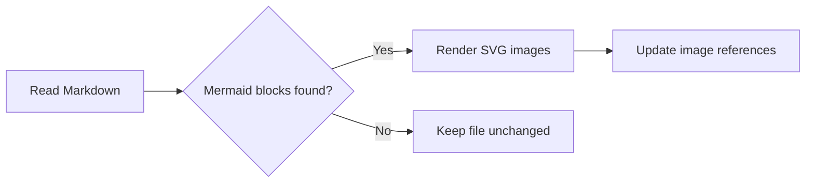
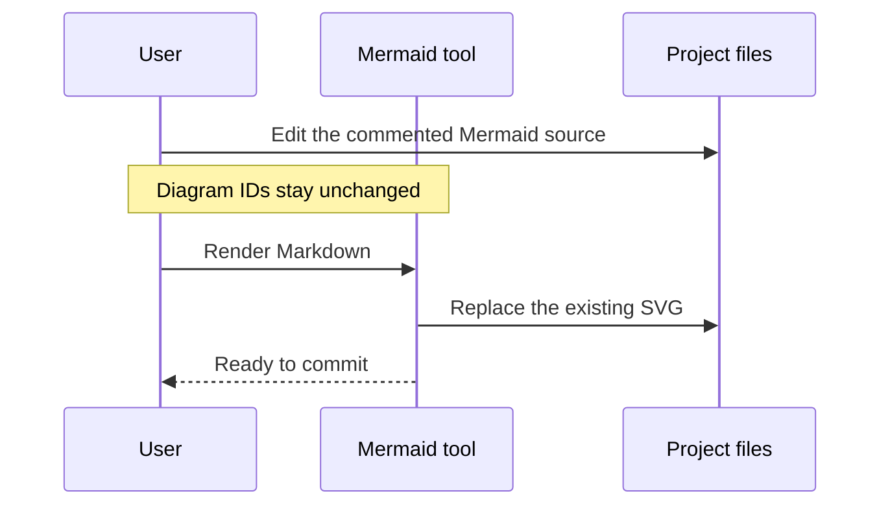

# Sample documentation project

This file contains two independent diagrams with ordinary Markdown between them. Rendering should keep each diagram in its original position and preserve the surrounding text.

## Rendering workflow

After rendering, change `Read Markdown` to `Read project files` directly in the commented source. Rendering again should update the same SVG.

This paragraph should remain between the two diagrams after rendering and restoring.

## Editing workflow

This second diagram tests participant labels, messages, a note, and more than one diagram in a single file.

See [architecture](docs/architecture.markdown), [workflows](docs/workflows.md), and [reports](docs/reports.markdown) for nested Markdown files.
