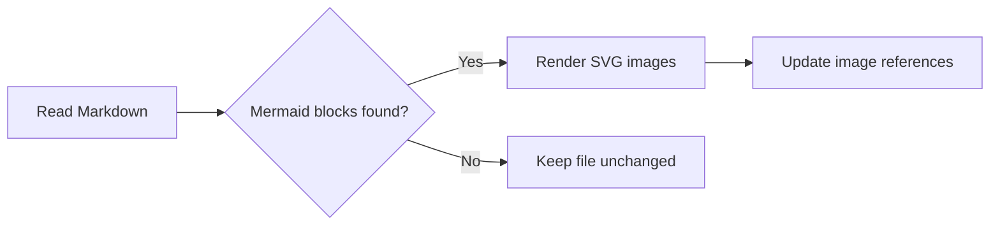
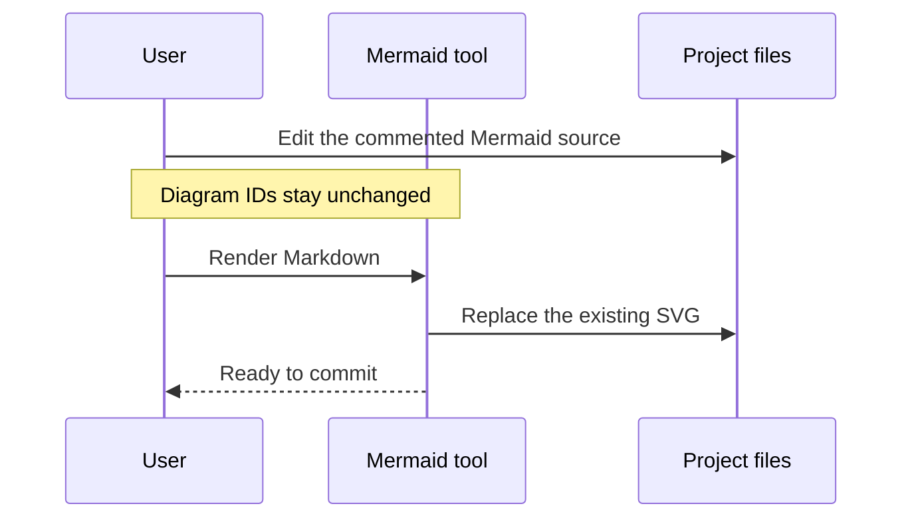

# Documentation pipeline

Mermaid diagrams describe the documentation pipeline and editing workflow.

## Rendering workflow

Rendering replaces diagram sources with references to generated SVG images.

## Editing workflow

Diagram identities persist across source edits.

See [architecture](docs/architecture.markdown), [workflows](docs/workflows.md), and [reports](docs/reports.markdown).
