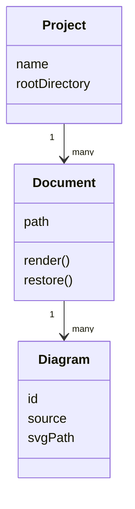
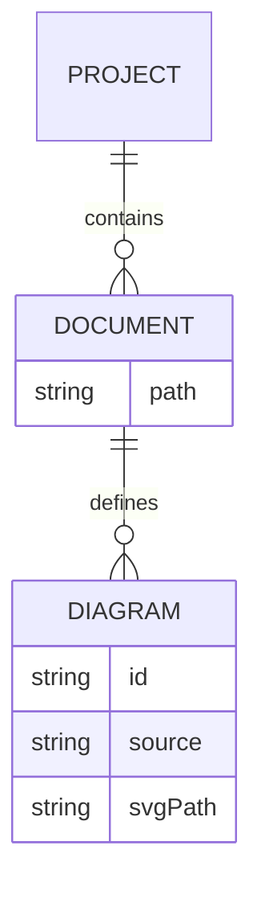

# Architecture

The documentation model connects projects, documents, and diagrams.

## Classes

Documents contain diagram sources and reference their generated images.

## Relationships

Diagram identities persist across source edits.
