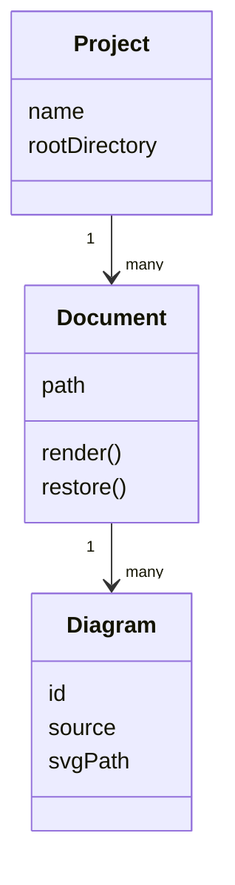
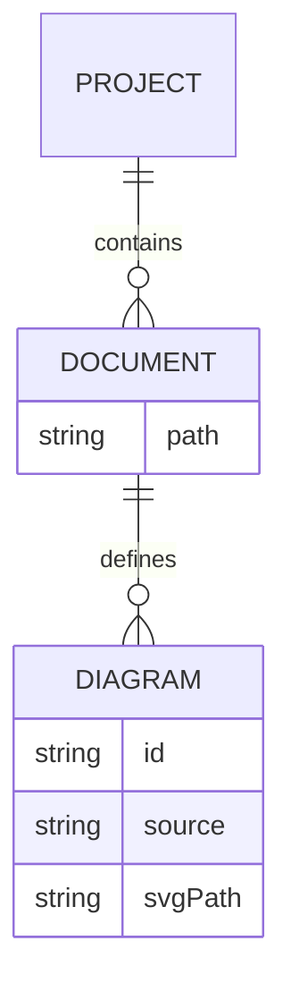

# Architecture

These diagrams test multiple diagram types in one `.markdown` file and image links from a nested directory.

## Classes

The text between diagrams should remain in place after rendering and restoring.

## Relationships

This closing paragraph should also remain unchanged.
