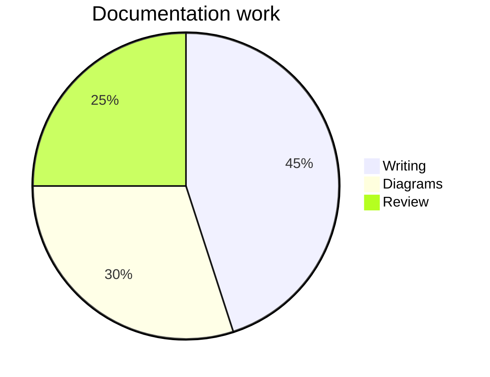
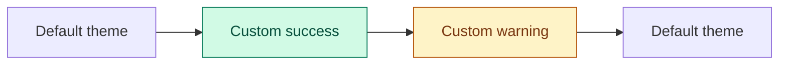

# Reports and custom colours

This file tests a pie chart and explicit colours that should remain fixed when the surrounding SVG switches between light and dark palettes.

## Example work breakdown

## Explicit styles

The default nodes follow the browser's light/dark theme automatically. The green and amber nodes keep the colours specified in their Mermaid source.
