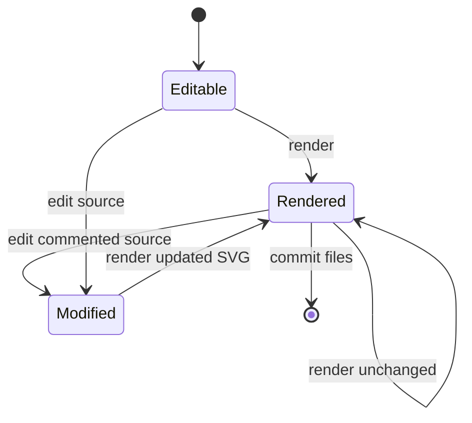

# Diagram lifecycle

This state diagram tests a different diagram type and makes a useful target for editing commented source directly.

After rendering this file, change `commit files` to `share documentation` in the source comment. Render again and check that the SVG filename stays the same. The optional restore command can still recover standalone Mermaid fences.
