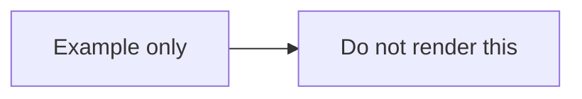

# A file that should not change

This file has no actual Mermaid diagrams. Rendering the whole example project should leave it byte-for-byte unchanged.

- Ordinary prose and lists stay as they are.
- Code blocks in other languages stay as they are.
- A Mermaid fence shown inside a longer Markdown code fence is an example, not a diagram to render.

## Ordinary code

```json
{
  "output": "docs/diagrams/",
  "theme": "auto"
}
```

## A quoted Mermaid example

The following is a Markdown code sample. Its inner Mermaid fence must stay visible as code:

````markdown

````

This final sentence should also stay unchanged.
