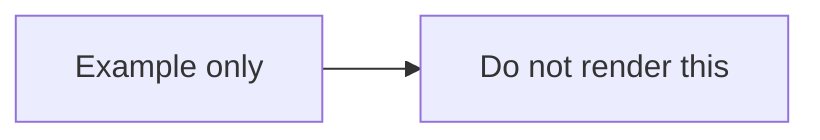

# Documentation notes

Documentation assets are stored under `docs/diagrams/`.

## Metadata

```json
{
  "output": "docs/diagrams/",
  "theme": "auto"
}
```

## Markdown example

Markdown can include fenced examples:

````markdown

````

Source examples accompany the project documentation.
